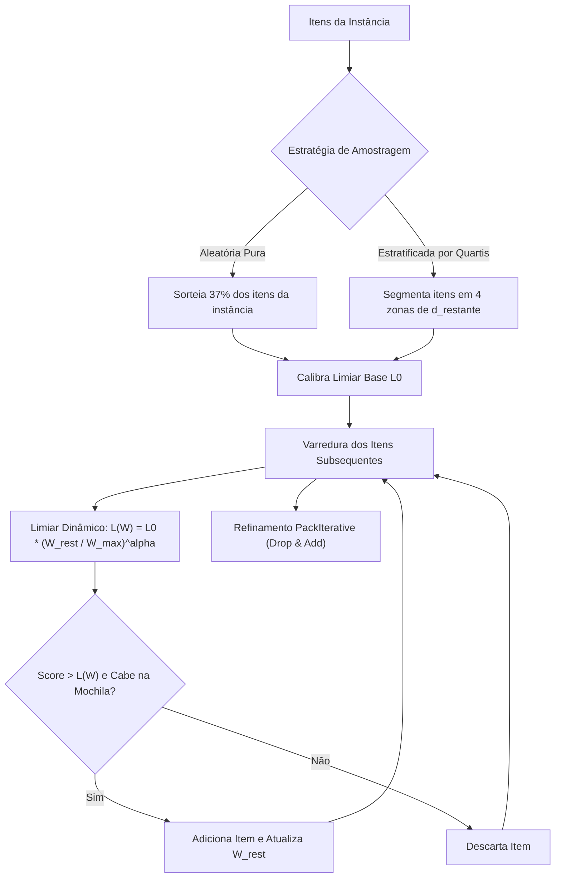
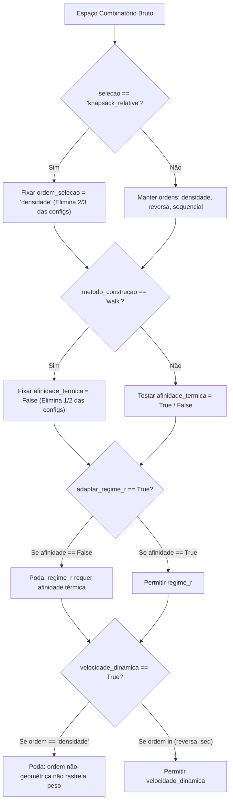

# 📋 Plano de Implementação: Otimizações da Heurística dos 37% e da Queimada

Este documento estabelece o plano formal de engenharia e experimentação para incorporar os avanços da literatura científica e as decisões alinhadas sobre a **Heurística dos 37%** (`heuristic_37`) e a **Heurística da Queimada** (`queimada`) no framework TTP.

---

## 🎯 1. Princípios e Decisões Alinhadas

Com base nas discussões conceituais e nos fundamentos teóricos do TTP:

| ID | Tópico | Decisão Tomada | Justificativa Matemática / Algorítmica |
| :--- | :--- | :--- | :--- |
| **A** | **Tour Completo** | **Manter visita a todas as cidades** | O TTP padrão exige ciclo Hamiltoniano completo ($N$ cidades). O foco de otimização interdependente está na geometria da rota (evitar desvios custosos em aluguel $R$). |
| **B** | **Sensibilidade a $R$** | **Incorporar $R$ na construção da rota** | Atualmente, $R$ é ignorado na fase de temperatura e dissipação de calor. O parâmetro `adaptar_regime_r` e a penalização térmica por $R$ corrigirão esse desacoplamento. |
| **C** | **Temperatura Nó $\to$ Depósito** | **Adotar Cota de Lucro Geodésica ("Cidade é a Última")** | Tratar a distância direta $d(u, 1)$ como lower bound invariante elimina o ciclo de causalidade e filtra itens com prejuízo garantido antes de guiar a rota. |
| **D** | **Velocidade Marginal** | **Ativar dinamicamente apenas quando condicionalmente válido** | Aplicar o custo marginal exato $v(W_{\text{atual}})$ apenas nas ordens em que o peso acumulado na rota é determinístico (`sequencial` e `reversa`). |
| **37** | **Amostragem e Limiares** | **Amostragem desacoplada e limiar adaptativo decrescente** | Resolver a distorção da ordenação geométrica da rota e evitar rejeição prematura sob restrições de mochila fracionária. |
| **EXP** | **Controle Combinatório** | **Poda estrita de combinações sem sentido físico** | Impedir a explosão do Grid Search através de um espaço ortogonal e condicional de dois estágios. |

---

## 🧩 2. Detalhamento Técnico das Modificações

### 2.1. Heurística dos 37% (`heuristic_37.py`)



#### Modificação 37.1: Amostragem Não-Espacial (Correção da Aleatoriedade)
* **Problema:** Os primeiros 37% da rota TSP têm a maior distância restante até a cidade 1 ($d_{\text{restante}} \approx D_{\text{total}}$), o que distorce a calibração para baixo ou gera scores negativos.
* **Implementação:**
  * Parâmetro `modo_amostragem: str = "estratificada"` (Opções: `"rota"` [legado], `"aleatoria"`, `"estratificada"`).
  * **Modo Aleatório:** Embaralha a lista global de itens e amostra os primeiros $\lfloor 0.37 \cdot M \rfloor$ itens independentemente da cidade em que estão.
  * **Modo Estratificado:** Divide a rota em quartis de distância ao depósito e calibra limiares independentes por quartil.

#### Modificação 37.2: Limiar Dinâmico Adaptativo (Knapsack Secretary)
* **Problema:** Um limiar único e estático rejeita itens viáveis na fase final da rota, quando transportar peso tem custo marginal quase nulo.
* **Implementação:**
  * Parâmetro `limiar_adaptativo: bool = True`.
  * Cálculo dinâmico a cada passo:
    $$L(W_{\text{atual}}) = L_0 \cdot \left(\frac{C - W_{\text{atual}}}{C}\right)^\alpha$$
    onde $C$ é a capacidade da mochila e $\alpha \in [0.5, 1.0]$. Conforme a mochila se aproxima da capacidade ou o ladrão chega perto do depósito, o corte relaxa suavemente.

---

### 2.2. Heurística da Queimada (`queimada.py`)

#### Modificação Q.1: Temperatura com Cota Inferior Invariante (Ponto C)
* **Problema:** Avaliar a temperatura como soma simples de valores ($\sum v_i$) atrai a rota para cidades com itens pesados e pouco lucrativos. Usar a distância da rota gera ciclo de dependência.
* **Solução:** Assumir a hipótese da *"Cidade como Última"* (a próxima paragem é o depósito 1). Como $d(u, 1)$ é uma cota inferior estrita para qualquer rota que passe por $u$, o custo de transporte mínimo absoluto é:
  $$C_{\text{min}}(item) = R \cdot \frac{d(u, 1)}{v_{\text{max}}} \cdot \frac{item.peso}{C_{\text{mochila}}}$$
* **Implementação:**
  * Novo modo de temperatura: `temperatura="net_value_depot"`.
  * Define o valor efetivo de cada item como $\max(0, item.valor - C_{\text{min}}(item))$ antes de acumular o calor no vértice $u$. Itens que geram prejuízo garantido têm calor zerado e não atraem a rota.

#### Modificação Q.2: Incorporação de $R$ na Rota e Dissipação (Ponto B)
* **Problema:** Atualmente, a dissipação matricial Numba e a construção da rota são 100% cegas para $R$.
* **Implementação:**
  1. **Ativação e ajuste de `adaptar_regime_r`:**
     Na afinidade térmica de Kruskal / Backward Edges:
     $$\text{Afinidade}(u, v) = \frac{\text{Calor}(u, v)}{d(u, v)^{\gamma(R)}}$$
     com $\gamma(R) = \min(3.0, \max(0.5, 0.8 + 0.4 \cdot R))$.
     *Em instâncias com aluguel $R$ agressivo, $\gamma$ aumenta, forçando a rota a respeitar a proximidade física e impedindo rotas longas.*
  2. **Penalização térmica opcional na dissipação:**
     Atenuação do calor propagado proporcional a $(1 + \lambda \cdot R \cdot d)$.

#### Modificação Q.3: Velocidade Marginal Dinâmica Condicionada (Ponto D)
* **Problema:** A linearização por $v_{\text{avg}}$ é necessária para ordenar candidatos fora da rota, mas é imprecisa quando os itens são inseridos de forma sequencial ou reversa.
* **Implementação:**
  * Novo parâmetro: `velocidade_dinamica: bool = False`.
  * **Regra Condicional Estrita:** Esse parâmetro só é executado se `selecao == "greedy_relative"` E `ordem_selecao in ("reversa", "sequencial")`.
  * Durante a iteração dessas ordens, à medida que cada item é testado, utiliza-se a velocidade instantânea exata:
    $$\Delta t = d_{\text{rest}} \cdot \left(\frac{1}{v(W_{\text{atual}} + w_i)} - \frac{1}{v(W_{\text{atual}})}\right)$$
    $$\text{Lucro Marginal} = v_i - R \cdot \Delta t$$
    Se o lucro for negativo, o item é descartado imediatamente.

---

## 🚫 3. Estratégia Antitravamento: Controle da Explosão Combinatória

O grid search ingênuo combinando todos os parâmetros geraria mais de **4.000 configurações**, tornando a execução lenta e inviável. Aplicaremos **três níveis de filtragem lógica**:

### Nível 1: Matriz de Deduplicação e Condicionalidade Lógica



### Nível 2: Poda de Parâmetros Conflitantes no Gerador de Espaço
No arquivo `scripts/experimentos_queimada/grid_search_paralelo.py`, as seguintes regras são aplicadas dentro do gerador:

```python
# 1. Poda de seleção Knapsack (ordem de varredura gulosa é nula no solver exato 0/1)
if sel == "knapsack_relative" and ordem != "densidade":
    continue

# 2. Poda de método walk (não utiliza afinidade térmica)
if metodo == "walk" and afinidade:
    continue

# 3. Poda de regime R (só atua no expoente gamma da afinidade térmica)
if adaptar_regime_r and not afinidade:
    continue

# 4. Poda de velocidade dinâmica (só opera sob varredura de peso conhecido)
if velocidade_dinamica and (sel == "knapsack_relative" or ordem == "densidade"):
    continue
```

### Nível 3: Protocolo Experimental em Dois Estágios (Ortogonal)
Em vez de testar todas as hipóteses simultaneamente, dividimos a exploração em dois estágios independentes:

* **Estágio 1 — Otimização de Rota e Campo Térmico (Pontos B e C):**
  * *Parâmetros fixos:* `selecao="greedy_relative"`, `ordem="densidade"`, `refinamento=True`, `otimizar_buracos=True`.
  * *Parâmetros variáveis:*
    * `temperatura`: `["total_value", "net_value_depot"]` (2 opções)
    * `dissipacao`: `["dijkstra", "bfs"]` (2 opções)
    * `metodo_construcao`: `["backward_edges", "backward_directed"]` (2 opções)
    * `adaptar_regime_r`: `[False, True]` (2 opções)
  * **Total de configurações no Estágio 1:** $2 \times 2 \times 2 \times 2 = \mathbf{16\text{ configurações}}$.

* **Estágio 2 — Otimização de Coleta e Velocidade Marginal (Ponto D):**
  * *Fixa:* A melhor configuração de rota obtida no Estágio 1.
  * *Parâmetros variáveis:*
    * `ordem_selecao`: `["reversa", "sequencial"]` (2 opções)
    * `velocidade_dinamica`: `[False, True]` (2 opções)
    * `refinamento`: `[True]` (Drop & Add garantido)
  * **Total de configurações no Estágio 2:** $2 \times 2 = \mathbf{4\text{ configurações}}$.

> [!TIP]
> Com essa estratégia em dois estágios, o espaço total cai de **~4.000 para apenas 20 execuções**, mantendo 100% de interpretabilidade e rigor estatístico.

---

## 📅 4. Cronograma de Execução e Arquivos Envolvidos

### Etapa 1: Atualização dos Solvers
1. **`heuristic_37.py`**:
   - Adicionar métodos de amostragem `aleatoria` e `estratificada`.
   - Adicionar função de decaimento do limiar $L(W_{\text{atual}})$.
2. **`queimada.py`**:
   - Implementar cálculo de temperatura `net_value_depot` com cota inferior euclidiana.
   - Implementar cálculo de custo marginal incremental quando `velocidade_dinamica=True`.
3. **`numba_kernels.py`**:
   - Garantir suporte em C/Numba para o limiar adaptativo e cota de temperatura rápida.

### Etapa 2: Testes de Integridade Regressiva
* Executar a suite de testes automatizados:
  ```powershell
  pytest ttp_simulator/tests/test_solvers.py
  ```

### Etapa 3: Bateria Experimental Controlada
1. Executar os scripts dedicados em lote nas instâncias de calibração:
   ```powershell
   python scripts/experimentos_37/grid_search_paralelo.py --espaco rapido
   python scripts/experimentos_queimada/grid_search_paralelo.py --espaco estagio1 --instancias leves
   ```
2. Analisar convergência e atualizar `ttp_simulator/src/config/melhores_configuracoes.json`.

---

## 📊 5. Critérios de Sucesso e Validação

1. **`heuristic_37`**:
   - Superar o score médio da versão atual (reverter o gap negativo histórico nas instâncias equilibradas).
2. **`queimada`**:
   - Aumentar o lucro líquido médio $G$ em instâncias com $R \ge 1.0$ (onde a sensibilidade ao aluguel é crítica).
   - Manter o tempo computacional dentro da margem de $\pm 10\%$ em relação à versão Numba atual.
